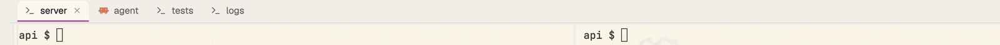

# Auto Tabs

Herdr's tab bar with tabs that name themselves: a Claude Code tab takes the title Claude sets, a
terminal tab its running program, or its folder at the prompt. The active tab is underlined in
the panes' focus-border colour, and names get more room before they're cut off.

## What you see

- The top bar (a 32 px row), `chrome` background, 1 px `border` line at the bottom, 10 px side
  padding (more on macOS with hidden titlebar, to clear the traffic lights).
- Tabs left to right, 3 px apart, scrolling sideways when they overflow. Each tab is 29 px tall,
  10 px padding, top corners rounded 7, 12.8 px text: the program's 14 px icon, the name (at most
  280 px, then truncated; " Z" added when zoomed), a status mark, and on the active tab a 12 px close icon.
- Active tab: the theme `background`, `foreground` semibold text, and a 2 px underline in the
  layout's pane focus colour (`accent` when the layout sets none). Others: `chrome`, `muted` text,
  underline in `chrome` (invisible). Hover: `hover` background.
- While `confirm-tab-close` asks about a tab: a 2 px dashed `ansi1` border around it.
- Right side: a 26 px "+" button, "Files" and "Changes" panel buttons (`selected` when open), and
  minimize / maximize / close when the window has its own buttons.

## How it behaves

- Agent status: working shows a 12 px `working` spinner (900 ms turn); blocked and done a 6 px
  dot in `blocked` / `done`; idle shows nothing.
- Naming, every 3 s: per tab, its Claude Code pane if any, else its first terminal. Claude's title
  without the leading spinner or ✳; else the program name; at a shell prompt, the folder name
  (`~` for the home folder). A tab you rename yourself keeps your name; "Claude Code" (the new-tab
  menu's default) and names this mod gave are replaced. Default `tbN` names show the program name.
- Click selects a tab; double-click renames (`tab.rename`); drag one tab onto another moves it
  (`tab.move`); right-click opens the shipped `menu` popup (200 px); the close icon runs `tab.close`.
- Wheel over the bar: `tab.prev` / `tab.next`. "+" opens the shipped `new-menu` popup (250x512).
- Files / Changes toggle the `panel` (`layout.select {stack:"panel-body", child}` + `layout.show`,
  or `layout.hide`); the open panel is remembered per space in `localStorage` and restored on switch.

## Built from

- `auto-tabs` (`mod.json` `{"place":"none","title":"Auto tabs","cloned_from":{"name":"tabs",
  "version":"0.1.9"}}`), a `mod.clone` of the shipped `tabs`, put in the layout's `tabs` block in
  place of `tabs` (`window_drag: true`).
- Changes from `tabs` 0.1.9: name `max_w(280)` (was 170); `rounded_t(7)` with `border_b_2()` in the
  focus colour, found by walking `layout()` for a `{tab, pane}` block's `content.pane.focus.color`
  and resolving it through `theme()`; the active tab on `t.background`; the `shared("confirm-tab-close.tab")`
  outline; `cx.timer.every(3000, syncNames)` in `init`.
- `names.js` `syncNames()`: `spaces()`, `panes()` (`app === "claude-code"`, `title`,
  `program.shell`, `program.name`, `cwd`, `terminal`), `tab.named`, `run("tab.rename", {id, name})`,
  and `shared("tab-titles.set")` / `setShared` (tab id -> the name it gave) to tell its own names
  from yours.
- Shipped assets: `mods/pane/close.svg`, `mods/workspace-chrome/spinner.svg`,
  `mods/files/file.svg`, `mods/changes/changes.svg`; shipped mods `menu`, `new-menu`; reads
  `shared("workspace.panels")` (default `["files","changes"]`).

## Watch out

- Mods can't import from another mod's folder: clone `tabs` (`mod.clone {name:"tabs",
  as:"auto-tabs"}`) and edit the copy; don't import from it. The shipped `tabs` has since moved
  on (swipe handling, live agent titles); this build is from 0.1.9.
- Remember which names you gave: without `tab-titles.set`, a renamed-by-us tab looks named by
  the person and would never update again.
- shortcut: the home folder is matched as `/home/<user>` or `/root`, so on macOS `/Users/<you>`
  shows your user name, not `~`.
- shortcut: only "Claude Code" counts as a replaceable default name; other agents' default names stick.
- Agent titles come from `panes()[].title` with the leading non-letter glyphs stripped; other
  agents get their program name.

## Done when

- A new terminal tab is named after its folder within 3 s, and after `vim` while vim runs.
- A Claude Code tab follows Claude's title, without the spinner glyph.
- Renaming a tab by double-click sticks; the next 3 s sync doesn't change it.
- The active tab's underline matches the pane focus border colour.
- With `confirm-tab-close`, Cmd+Shift+W outlines the tab in red dashes until answered.
- Working, blocked and done tabs show the spinner and dots; drag reorders; wheel switches tabs.
