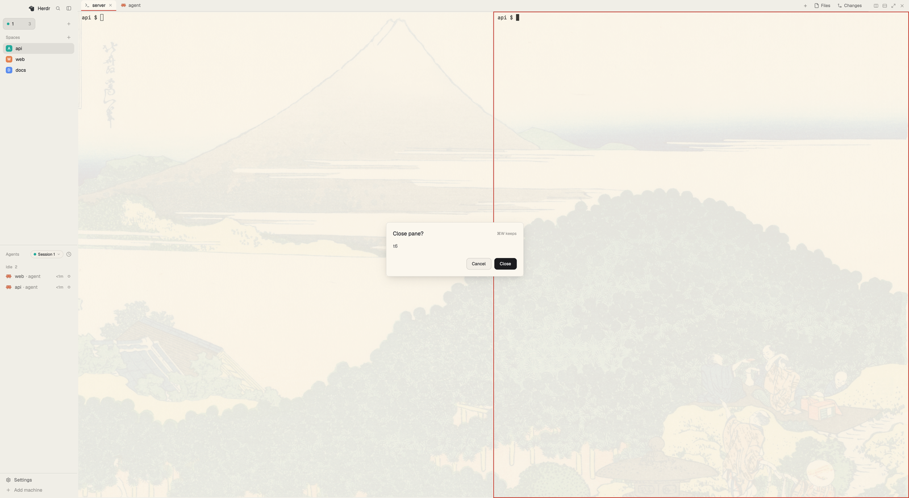

# Confirm Close

Cmd+W and Cmd+Shift+W ask before they close anything. Cmd+W shows a small "Close pane?" box
and turns the focus border of the pane that would close red; Cmd+Shift+W shows a "Close tab?"
dialog, outlines that tab in the tab bar with a red dotted border, and says how many panes go
with it.

## What you see

- **Close pane?** (`cmd-w`): a 380x150 window, `popover` background, 18 px padding, 12 px gaps.
  Title row: "Close pane?" in 15 px semibold `foreground`, "⌘W keeps" in 11 px `dim` on the right.
  Then the pane's title in `muted`, truncated ("Its terminal ends." when it has none). Bottom right,
  two 32 px buttons, radius 8, 12 px text: Cancel (`raised`, `input` border) and Close (`solid`,
  `solid_foreground`). The rest of the app stays bright, and the focused pane's border becomes
  2 px `ansi1` until the box goes away.
- **Close tab?** (`cmd-shift-w`): a 380x150 centered dialog with the same look: "Close tab?",
  "Esc" hint, "Its pane closes too." or "Its N panes close too.", Cancel and Close. With the
  `auto-tabs` tab bar, the tab in question gets a 2 px dashed `ansi1` border while it asks.

## How it behaves

- Close pane: the terminal keeps the keyboard, so Enter and Esc go to the terminal, not the box.
  Click Close to close the pane (`pane.close`); click Cancel, or press Cmd+W again (`mod.open`
  toggles the overlay), to keep it. However it ends, the old focus border comes back.
- Close tab: the dialog takes the keyboard. Enter closes the tab, Esc or Cancel keeps it and
  hands focus back to the pane that had it. Closing a space's last tab doesn't ask a second time.
- With no focused pane or tab, the overlay closes itself at once.

## Built from

- `keys.json` `global`: `"cmd-w": "mod.open:confirm-pane-close"`,
  `"cmd-shift-w": "mod.open:confirm-tab-close"`.
- `confirm-pane-close` (`mod.json` `{"place":"none","overlay":{"kind":"window","width":380,
  "height":150}}`). `init`: `focused().pane`, looked up in `panes()` for its title. It walks
  `layout()` for every `{tab, pane}` block's `content.pane` look, saves the first one's `focus` in
  `setShared("confirm-pane-close.focus", …)` (default `{width:1,color:"accent"}`), sets every look's
  `focus` to `{width:2,color:"ansi1"}` and calls `run("layout.set", {layout})`, which applies live.
  `restore()` reads the saved look, clears the key and paints it back; Close, Cancel and the
  overlay's `close()` all call it. Close then runs `closeOverlay(props().overlay)` and
  `run("pane.close", {pane})`.
- `confirm-tab-close` (`{"place":"none","overlay":{"kind":"dialog","width":380,"height":150}}`).
  `init`: `focused()` tab and pane, pane count from `panes()`, `cx.focus_handle()` focused with
  `cx.timer.after(30, …)`, `setShared("confirm-tab-close.tab", tab)`. The root has
  `track_focus` and `on_key_down` (`enter` / `escape`, then `cx.stop_propagation()`). Close runs
  `run("tab.close", {id, confirmed: true})`; Cancel runs `pane.focus {pane}`. `close()` and both
  buttons set the shared key back to `null`.
- `auto-tabs` reads `shared("confirm-tab-close.tab")` and adds `border_2().border_dashed()
  .border_color(t.ansi1)` to that tab. Without it, the dialog works and nothing is outlined.

## Watch out

- The pane box must be a `window` overlay, not a `dialog`: a dialog dims the app and hides every
  pane's focus border, so you can't see which pane closes.
- `herdr-app check` runs `init` and commands for real. Both mods skip the layout change and
  `setShared` under `checking()`; without that guard a check once left the person's border red.
- A saved look that's already in `shared()` (the app quit mid-question) is the real one: keep it
  rather than saving the red border over it.
- Focusing the dialog in the same keypress that opened it doesn't hold; wait 30 ms. A dialog
  opened by another mod doesn't get the keyboard, so draw it here rather than opening the shipped
  `confirm` mod.
- Mods can't import from another mod's folder and only a pane's header mod can draw inside a
  pane, so the tab outline lives in the tab-bar mod and the two talk through `shared()`.
- The red border is the layout's pane look, so every pane's focus border is red, but only the
  focused pane shows one. A layout without `{tab, pane}` blocks gets no red border.

## Done when

- `cmd-w` opens "Close pane?" with the pane's title; its border is 2 px red; the rest isn't dimmed.
- Clicking Close closes that pane; the next pane's border has its old colour and width.
- `cmd-w` twice, or Cancel, keeps the pane and restores the border.
- `cmd-shift-w` shows "Close tab?" with the pane count and a red dotted outline on the tab in `auto-tabs`.
- Enter closes the tab (the last tab of a space too, without a second question); Esc keeps it,
  the outline goes, and typing reaches the pane again.
- `herdr-app check confirm-pane-close` leaves the focus border as it was.
