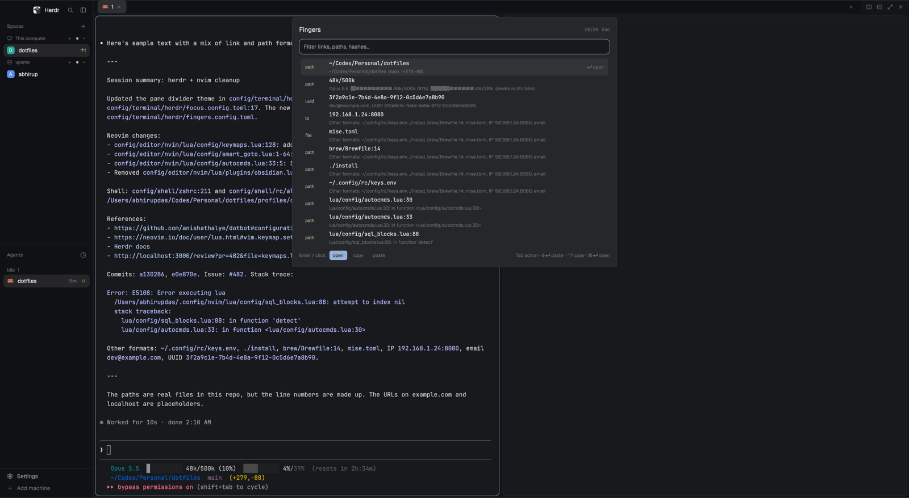

# herdr-fingers-native

[tmux-fingers](https://github.com/Morantron/tmux-fingers) for the **Herdr desktop app**: every
URL, path, git hash, UUID, IP and issue number on a terminal's screen, one keypress away. Two
ways in:

- **Hints** (`cmd-shift-f`): the pane's text is redrawn in place with a short hint on each
  match. Type the hint to open it; hold Ctrl to copy, Shift to paste it into the pane.
- **Picker** (`cmd-shift-o`): a native popup listing every match.
  Fuzzy-filter, move with the keyboard or the mouse, act with Enter or a click.



A native-app take on [herdr-fingers](https://github.com/ryanlewis/herdr-fingers) (the Herdr TUI
plugin): no Rust binary, no TUI plugin API, just two Herdr app mods and one Python file.

## Install

Needs the Herdr app (0.1.10+) with herdr-core (`hc`), and macOS (`open`, `pbcopy`,
`/usr/bin/python3`).

```sh
git clone https://github.com/abhirup-dev/herdr-mods
cd herdr-mods
make install
```

`make install` copies `mods/*` into `~/.config/herdr-app/mods/` (or `$HERDR_APP_HOME`), adds the
keys from `keys.json` unless you already use them, and writes a default config. Run it again
after `git pull` to update; the app hot-reloads. `make uninstall` moves the mods to the Trash and
unbinds the keys; your config stays.

## Use

| Hints (`cmd-shift-f`) | |
|---|---|
| hint | the default action (`open`) |
| `ctrl`+hint | copy |
| `shift`+hint | paste into the pane |
| `tab` | cycle the default action: open → copy → paste |
| `o` / `y` / `p` | numeric hints only: open / copy / paste (digits can't carry Ctrl or Shift) |
| `esc`, `q` | cancel |

| Picker (`cmd-shift-o`) | |
|---|---|
| type | fuzzy-filter (text and kind: `url`, `file`, `sha`…) |
| `↑` `↓`, `ctrl-j` `ctrl-k`, `ctrl-n` `ctrl-p` | move (the list scrolls with it) |
| `enter`, click | the selected action (chips at the bottom, or `tab` to cycle) |
| `shift-enter` / `ctrl-y` / `cmd-enter` | paste / copy / open |
| `esc` | close |

Open: URLs go to the browser. Files (with or without `:line:col`, relative to the terminal's
folder or its git root) go to your `editor`, else to macOS `open`; folders go to `open`. With an editor, a file that doesn't exist opens too, as a new buffer: an absolute
or `~` path as written, a relative one under the terminal's folder. Without one it's copied.

### Other machines

A terminal on another machine (a space on `vps`, address `vps/t7`) works the same way, through
herdr-core: its screen is read with `hc read`, file candidates are checked there in one
`hc exec --on vps` (its folder, its git root, its `~`), and a file opens in that machine's editor
(`hc run --on vps`, or a split or tab, which start there because the space lives there). URLs,
copy and paste stay on this Mac; a folder there opens in its editor, since Finder can't reach it.
Nothing is installed on the other machine; it needs `sh`.

### Editor

By default (`"editor": "env"`) a file opens in the editor of the machine it's on: that machine's
login-shell `$VISUAL`, then `$EDITOR`, then its system default (`editor` on Debian), then `vi`.
Set `editor` to a command to use that everywhere, or `null` for macOS `open`. It's placed per
`open_in`:

| `open_in` | Where | |
|---|---|---|
| `"float"` | a window over the layout | looks like a pane; drag it by its header. Its icons match a pane header: dock to the right, dock below, or dock and zoom; then the app's top-center grip moves it anywhere in the tab. ✕ ends it. Click into it to type. |
| `"split"` | a pane beside the one you were in | `split`: `"right"` or `"down"` |
| `"tab"` | a new tab in the same space | runs in your login shell, which stays when the editor quits |

## Configure

`~/.config/herdr-fingers-native/config.json` (or `$FINGERS_NATIVE_CONFIG`), read on every use:

```json
{
  "hints": "alphabet",
  "alphabet": "asdfgklwertyuopzxvbn",
  "action": "open",
  "editor": "env",
  "open_in": "float",
  "patterns": { "jira": "\\b[A-Z][A-Z0-9]+-\\d+\\b", "kubernetes-pod": false }
}
```

| Key | Values | Default |
|---|---|---|
| `hints` | `"alphabet"` (`aa`, `as`, `ad`…) or `"numeric"` (`1`, `2`… or `11`, `12`…) | `"alphabet"` |
| `alphabet` | your own hint characters, at least 2, no `q`; overrides `hints` | per `hints` |
| `action` | what a plain hint, Enter and a click do: `open`, `copy`, `paste` | `"open"` |
| `patterns` | `{"name": "regex"}` adds or replaces a pattern, `{"name": false}` turns one off | `{}` |
| `editor` | `"env"`: each machine's `$VISUAL` / `$EDITOR` / default editor, given `+line path`. Or a command: `{path}`, `{line}`, `{col}` are filled in (words holding a missing `{line}`/`{col}` are dropped; no `{path}` appends `+{line} {path}`). `null`: macOS `open`. No shell parses a file name | `"env"` |
| `open_in` | `"float"`, `"split"` or `"tab"` (see Editor) | `"float"` |
| `split` | for `open_in: "split"`: `"right"` or `"down"` | `"right"` |

Built-in patterns are the set finalized for the herdr-fingers TUI plugin, with its regexes:
`file` (anchored paths, or paths ending in an extension, with `:line[:col]`), `ip`, `uuid`,
`sha`, `url` (also `git@`, `ssh://`, `file:///`), `kubernetes-pod`, `git-status`,
`git-status-branch` and `diff`. Left out as false positives: any `word/word` path
(`open/copy/paste`, `48k/500k`), Kubernetes kinds inside words, bare numbers and hex. When two
matches overlap, the leftmost wins; at the same column, the order above. A `(?P<match>…)` group
in a pattern narrows the match to that group. Hints are all the same width, so none is a prefix
of another, and the matches nearest the prompt get the first ones.

## How it works

```
cmd-shift-f → fingers-native (mod)
   hc run --bg --rm fingers.py hints <terminal> <pane>   → a new core terminal
   terminal.show {terminal, pane}                         → drawn in the pane, same size
fingers.py: hc read → patterns → hints → key → terminal.show {pane} (pane back) → act

cmd-shift-o → fingers-native-picker (mod, popup)
   exec fingers.py list <terminal> → {config, cwd, matches} → fuzzy list → act
```

Both modes use the same matcher and config (`fingers.py`).

## Limits

- No colours while hints show: herdr-core gives a screen's text, not its styling.
- No OSC 8 hyperlink targets (the TUI plugin's `--links`): the app exposes none.
- Wide characters (CJK, emoji) on a line can shift the hints after them.
- macOS only for now (`open`, `pbcopy`).

## Develop

```sh
make test      # Python matcher/hints/config tests and the picker's fuzzy tests (node --test)
make install   # copy into the app; it reloads
make check     # herdr-app check on the installed mods
```

The app's own guide is the API reference: `~/.config/herdr-app/AGENTS.md`, `herdr.d.ts` and
`gpui-kit.d.ts`. See `AGENTS.md` here for the dev loop and what tripped the build up, and
`RECIPE.md` for the brief herdr.dev/mods expects.

## License

MIT
