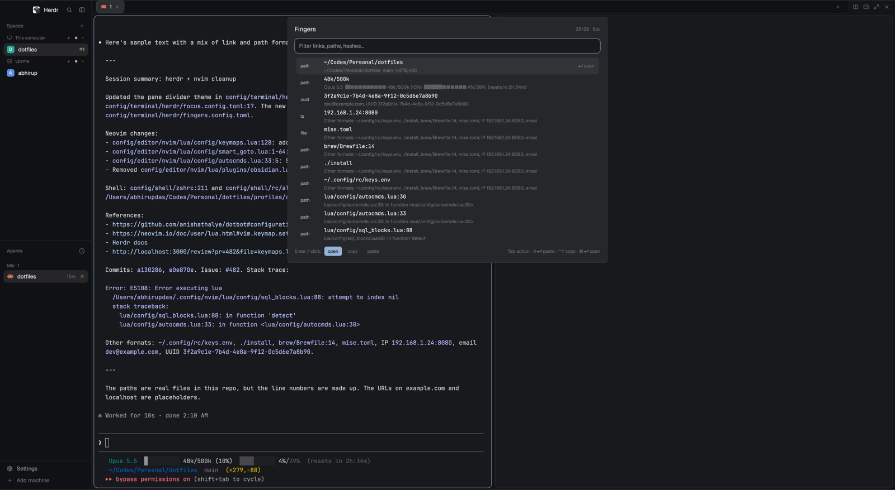

# Fingers

tmux-fingers for the Herdr app. One key redraws the focused pane's text in place with a short
yellow hint on every URL, file path, git hash, UUID, IP, pod name and git-status/diff file; typing the hint opens,
copies or pastes it. Another key opens a popup listing the same matches, fuzzy-filtered as you type.

## What you see

- **Hints** (`cmd-shift-f`): the focused pane shows its own text, dimmed; each match is in
  yellow (`ansi` 33) with its hint in black on yellow over the match's first characters. Hints
  are one or two characters, all the same width. A reversed badge in the top-right corner shows
  the current action (`open · tab: ctrl copy · shift paste`). The pane keeps its size and place.
- **Picker** (`cmd-shift-o`): a popup at the top of the window, 760 px wide, `popover`
  background, 16 px padding. A title row (`Fingers`, a `shown/total` count, `Esc`), a 36 px
  input with an `accent` border, then one-line rows 34 px tall: the match's kind in 10.5 px semibold
  (url `ansi4`; file, git and diff `ansi2`; sha `ansi3`; uuid `ansi5`; ip `ansi6`; pod `ansi1`), the
  match in JetBrains Mono 12.5 px. The selected row has the `hover` background and `⏎ <action>`
  on its right. The list is a virtual list, at most 440 px, sized by all matches (not the filtered
  ones) so the popup keeps its height; the selection scrolls it.
  A footer holds the action chips (open, copy, paste; the current one `accent`) and a key legend.

## How it behaves

- Hints: typing a hint's first character dims the hints that no longer fit. A full hint acts
  and the pane gets its own terminal back. Ctrl+hint copies, Shift+hint pastes into the pane,
  a plain hint does the configured action. Tab cycles the action; in numeric mode `o`, `y`, `p`
  pick it. Esc, `q` or ctrl-c cancel.
- Picker: typing filters by subsequence, ranking consecutive letters and word starts higher;
  ↑/↓ and ctrl-n/ctrl-p move; Enter or a click does the selected action; shift-enter pastes,
  ctrl-y copies, cmd-enter opens; a click on a chip sets the action; Esc closes.
- Open: an `http(s)` URL opens in the browser; a path that exists (after dropping `:line:col`,
  relative to the terminal's live folder) opens with `open`; anything else is copied.
- Agent status doesn't matter: it works on any terminal pane, agent or shell.

- Files open in the configured `editor` (`nvim +{line} {path}`): with `open_in: "float"` a
  frameless window (62% × 72%) drawn with the layout's pane look (background, border, radius 10)
  and a 30 px header in the style of the app's `pane` mod (icon, file, folder; dock right / below run
  `terminal.keep {place}`; dock-and-zoom waits for the new pane in `panes()`, then `pane.zoom`;
  close runs `terminal.kill`) over a live terminal. Dropping a
  window straight into the tab isn't possible: the grip only moves tab panes; `"split"` a pane beside the
  source; `"tab"` a new tab.

## Built from

- Mods: `fingers-native` (`mod.json` `{"place":"none","overlay":{"width":2,"height":2}}`, a
  2 px launcher) and `fingers-native-picker` (`{"place":"none","overlay":{"kind":"popup",
  "at":"top","offset":40,"width":760,"height":0.7}}`). Keys: `mod.open:fingers-native`,
  `mod.open:fingers-native-picker`.
- `fingers-native/main.js`, `init`: `focused()` for the terminal and pane; `hc(["run","--bg",
  "--json","--rm","--no-parent","--","/usr/bin/python3","-I",<mod>/fingers.py,"hints",t,pane])`;
  waits (`cx.sleep(25)`, up to 1 s) until `terminals()` lists the new address; `closeOverlay`;
  then `run("terminal.show", {terminal, pane})`.
- `fingers.py hints`: `hc get --json` (cwd from `foreground.cwd`), `hc read --json` (`text`),
  regexes, hints, raw-mode key loop; then `herdr-app do terminal.show '{"pane":…}'` and the
  action (`open`, `pbcopy`, `herdr-app do terminal.paste`).
- `fingers.py list <t>`: JSON `{config, cwd, matches:[{text, kind, row, line, file}]}` for the
  picker, which runs it with `exec` and acts with `cx.open_url`, `cx.write_to_clipboard`,
  `exec("open")` and `run("terminal.paste")`.
- Config `~/.config/herdr-fingers-native/config.json`: `hints` (alphabet|numeric), `alphabet`,
  `action`, `patterns` (add/replace regexes, `false` disables).

## Watch out

- Another machine's terminal (`vps/t7`): fingers.py runs here and reaches it only through
  herdr-core: `hc read`, one `hc exec --on vps -- sh -c REMOTE_CHECK` for every file candidate,
  `hc run --on vps` for the editor. The picker hands files to the editor mod through the request
  file plus `mod.open`, as hints mode does: an overlay opened from the picker with props stalled
  while a remote space was shown (until the next mod reload, which then started them all).
- A virtual list's rows can't hold handlers (`on_click` throws, silently: an empty list), so the
  picker uses the list's `on_item_click`. Every row must be exactly the list's item height.
  `herdr-app check` doesn't draw deferred rows: try the list in the app.
- The editor mod must open the float **before** closing its own launcher overlay: closed first,
  the task is dropped silently and the editor runs with no window. The launcher is a 2 px
  `window`, not a popup, so nothing can dismiss it mid-launch.
- A window's terminal starts at the core's 200x120 and is resized on the window's first paint
  (none while the app is off screen). An editor drawn before that keeps a broken screen, so the
  float runs it through `/bin/sh -c` that waits for the size to change (max 2 s) and then
  `exec "$@"`s it.
- Only a mod can open an overlay, so `fingers.py` hands a file to the editor mod through
  `fingers-native-open.json` in the app folder plus `herdr-app do mod.open`. `pane.focus` can't
  reach a window's terminal: the float takes the keyboard on a click.
- Don't `fs.exists` the `python3` link from a mod: it points outside the folders a mod may read
  and the call throws. Run it (`exec`, `hc run`) instead.

- The launcher must close its own overlay **before** `terminal.show`, and the app learns of a
  terminal a moment after `hc run` returns: show it too early or with the overlay open and
  nothing happens.
- A mod's setup goes in `init(props, cx)`; the constructor gets no `cx`.
- A popup sizes to its content: a `flex_1` list inside it is 0 px tall. Give it a height.
- A mod folder the app sees without `mod.json` is docked into the shown layout at 320 px. Copy
  mods in whole (stage, then rename), as `scripts/install.sh` does.
- The path regex must not nest quantifiers (`(?:/?x+)+` hangs on long words).
- Patterns are the herdr-fingers TUI set as finalized (generic word/word paths, k8s kinds,
  digits and hex left out as false positives). Overlaps: leftmost match wins, then pattern
  order; `sha` needs a letter and word boundaries, or a timestamp reads as a hash.
- `hc read` is plain text; colours are lost while hints show. Wide characters shift hints.
- Digits can't carry Ctrl/Shift in a raw terminal, hence `o`/`y`/`p` in numeric mode.

## Done when

- `cmd-shift-f` on a pane with paths and URLs shows hints over them, in the pane, at its size.
- Ctrl+hint puts exactly that text on the clipboard and the pane shows its terminal again.
- With `"hints": "numeric"`, hints are digits and `y` then a hint copies.
- `cmd-shift-o` lists every match, typing narrows it, ↑/↓ or ctrl-j/ctrl-k scroll to any row, Enter acts.
- `make test` passes.
