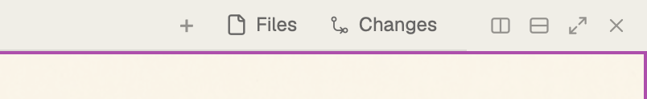

# Pane Actions

The pane header's split, zoom and close buttons, moved to the right end of the tab bar. They act
on whichever pane has focus, so panes can go without headers and still be split, zoomed or closed
with the mouse.

## What you see

- A 112 px block at the right of the 32 px top bar, beside the tab bar. Four 14 px icons,
  right-aligned, 2 px apart, 8 px from the right edge: split right, split down, zoom (unzoom when
  the focused pane is zoomed), close.
- Icons are `dim`; hovering one gives it a `hover` background (4 px padding, radius 4) and
  `foreground` colour.
- With no focused pane, the block is empty.

## How it behaves

- Split right: `pane.split {direction:"right", pane}`; split down: `direction:"down"`.
- Zoom / unzoom: `pane.zoom {pane}`; the icon flips with the pane's `zoomed`.
- Close: `pane.close {pane}`, straight away (Cmd+W with `confirm-close` is the asking route).
- Clicks stop propagation, so they don't start a window drag; the empty part of the block drags
  the window (`window_drag: true`).

## Built from

- `pane-actions` (`mod.json` `{"place":"none","title":"Pane actions"}`), placed in the layout's
  top bar: `{"id":"pane-actions","type":"block","content":{"mod":"pane-actions"},"size":{"px":112},
  "window_drag":true}` after the `tabs` block in the `top-bar` row (32 px).
- `focused().pane`, `panes()` for `zoomed`, `theme()` tokens `dim`, `hover`, `foreground`, `run`.
- Icons from the shipped `pane` mod: `svg("mods/pane/<icon>.svg")` for `split-right`,
  `split-down`, `zoom`, `unzoom`, `close`.

## Watch out

- Only a pane's header mod can draw inside a pane, and the app doesn't tell mods where panes are
  on screen, so these buttons can't sit on the pane they act on; they follow focus instead.
- Mods can't import from another mod's folder, but `svg()` paths resolve from the app folder, so
  the shipped `pane` icons can be used as-is.
- `mod.json` needs `place: "none"`, or the app docks the mod at 320 px on its own.
- Give the block a fixed px size; four buttons need about 112 px.

## Done when

- Clicking split right / split down splits the focused pane that way.
- Zoom zooms the focused pane and the icon turns to unzoom; clicking again unzooms.
- Close closes the focused pane without asking.
- Moving focus to another pane makes the buttons act on that one.
- Dragging the empty part of the block moves the window; clicking a button doesn't.
