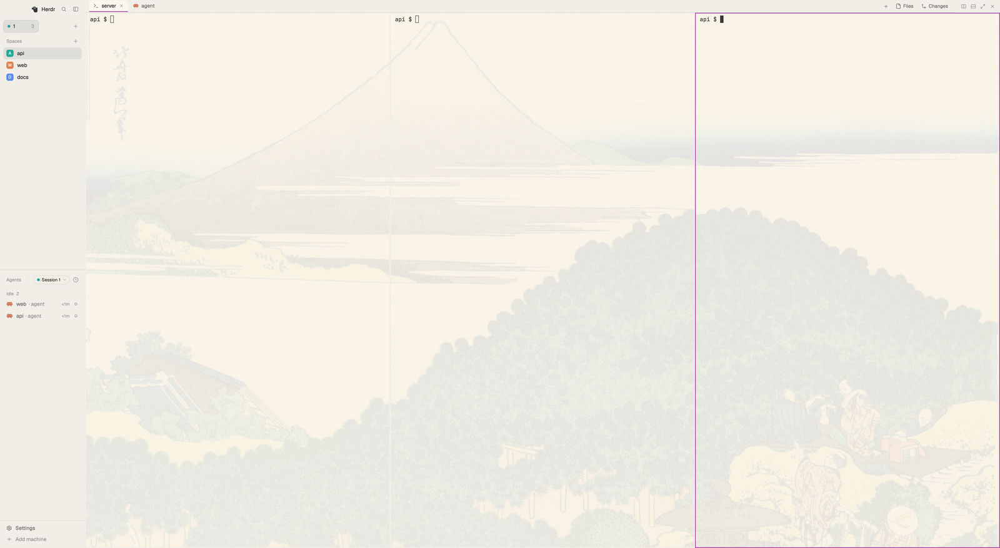

# Pane Equalize

Equalize When Linear Tiling. In a tab whose panes sit in one straight line (all side by side, or
all stacked), splitting or closing a pane resizes the line the way you'd expect and keeps your own
proportions: a new pane gets the line's average share, a closed pane's share goes back to the rest.
Cmd+Alt+E evens out every split of the focused tab. Nothing is drawn.

## What you see

- No region of its own: a 0 px block in the layout. You see only pane sizes change about a
  quarter second after a split or close.

## How it behaves

- Split in a line of panes: the app halves the split pane; this gives that pane its share back
  and gives the new pane the average of the others, so the others shrink in proportion. Three
  even panes become four even panes.
- Close in a line: the app gives the whole share to the left neighbour (right, when the closed
  pane was first); this takes that share back off the neighbour and spreads it in proportion.
- A divider you dragged is never undone; a line you never resized stays even.
- A tab with a split inside a split (nested tiling) is left alone on split and close.
- Cmd+Alt+E: every split of the focused tab, nested ones too, gets equal shares; fixed-px sizes stay.
- Zooming or unzooming a pane (Cmd+Shift+Enter) evens out that tab; changing the app zoom
  (Cmd +/-/0) evens out the focused tab.
- Only this computer's spaces; tabs on other machines are left alone.

## Built from

- `pane-equalize` (`mod.json` `{"place":"none","title":"Equalize When Linear Tiling",
  "overlay":{"kind":"popup","width":1,"height":1}}`), two roles:
  - Working copy: a layout block `{"id":"pane-equalize","type":"block","size":{"px":0},
    "content":{"mod":"pane-equalize"}}` in the root of the layout, so it runs whatever is shown.
    `render` watches `panes()` per tab (skipping ids with `/`, remote panes), `spaces()` tabs'
    `zoomed`, `settings().zoom` and `focused().pane`, and spawns work; it returns an empty `div()`.
  - Overlay copy (`props().overlay` set): `keys.json` `"cmd-alt-e": "mod.open:pane-equalize"`;
    evens the focused tab, `setShared("pane-equalize.forced", Date.now())`, `closeOverlay`.
- Herdr has no pane-size command. Sizes live in the herdr-core document `herdr-app`
  (`spaces[].tabs[].root`, nodes `{type, id, children, size:{weight}|{px}}`). The mod reads and
  writes it over JSON-RPC: `exec("sh", ["-c", 'printf "%s\n" "$1" | hc connect', "sh", line])`
  with `doc.get {name:"herdr-app"}` and `doc.set {name, value, version}`. The app follows the doc live.
- `adapt.js` `adapt(children, was, before)`: the split and close rules above, as weights; `null`
  when there's nothing to change. Runs `hc` (herdr-core CLI) as a program.

## Watch out

- Every `doc.set` names the version it read, so a write that races the app's own save fails;
  read again and retry (3 tries for force, 6 tries 250 ms apart after a pane change).
- After a pane change, wait until the saved tree's leaves match the new pane set before adapting.
- A close needs the closed pane's share from before. It is noted at start, after a forced
  equalize, and whenever focus moves; a tab mid-change isn't re-noted. shortcut: a divider
  dragged and then closed without focus moving in between uses the share from before the drag.
- `line()` looks through one-child wrappers (a tab split only downward is a row holding one
  column); anything with a split inside a split is not a line.
- `mod.json` must say `place: "none"`, or the app docks the mod at 320 px; add the 0 px block to
  the layout yourself. The overlay is 1x1 because it draws nothing.
- Assumes `hc` is on the `PATH` the app gives mods and talks to the local core.

## Done when

- Three even side-by-side panes, split one: four even panes.
- Drag one divider, split another pane: the dragged proportions stay, the new pane gets the average.
- Close a middle pane: the rest keep their proportions to each other (not one neighbour fat).
- A tab with a nested split: split or close leaves the other sizes as the app made them.
- `cmd-alt-e` on a lopsided tab, nested splits too: every split even; no overlay remains.
- Zoom then unzoom a pane: the tab comes back even.
